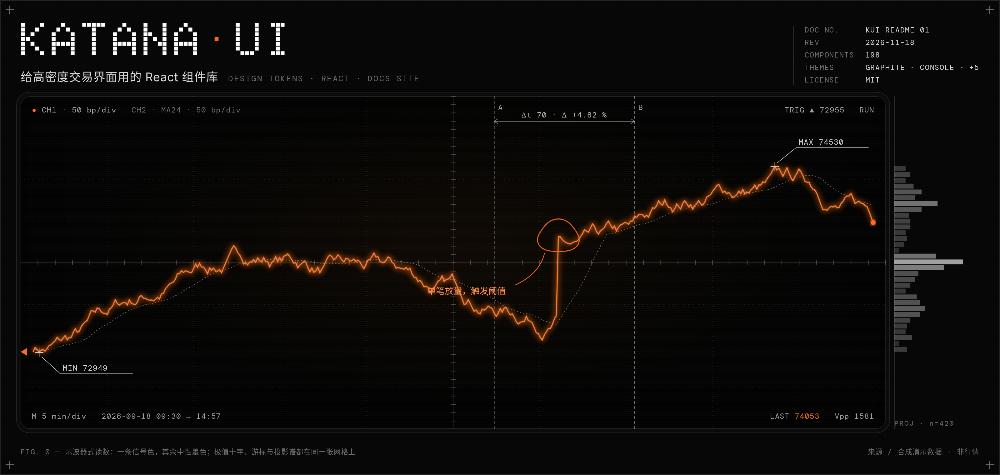
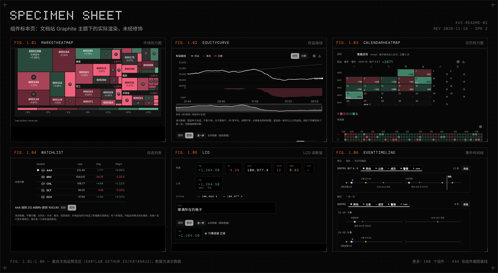

# Katana UI

English · [中文](README.zh-CN.md)



A design system for dense, data-heavy interfaces such as trading consoles and dashboards: design tokens, a React
component library and its documentation site, in one repository.

| Package | Path | What it is |
| --- | --- | --- |
| `@katana-ui/react` | [packages/react](packages/react) | Components, Tailwind v4 theme, motion, tokens, documentation site |

A separate `@katana-ui/tokens` package (three token layers and density modes) is next; until then the tokens ship
inside `@katana-ui/react`.



- **Documentation and live previews:** <https://xartlab.github.io/KatanaUI/>
- **How to install and use the components:** [packages/react/README.md](packages/react/README.md)
- **Contributing:** [CONTRIBUTING.md](CONTRIBUTING.md)
- **License:** MIT, see [LICENSE](LICENSE)

```sh
pnpm install
pnpm dev          # documentation site
pnpm fast         # checks for what you changed, under a minute
pnpm full         # full gate: unit, component screenshots, page screenshots, e2e
pnpm test         # format, lint, generated-file checks, unit tests
pnpm typecheck
pnpm build:site   # documentation site and shadcn registry
```
