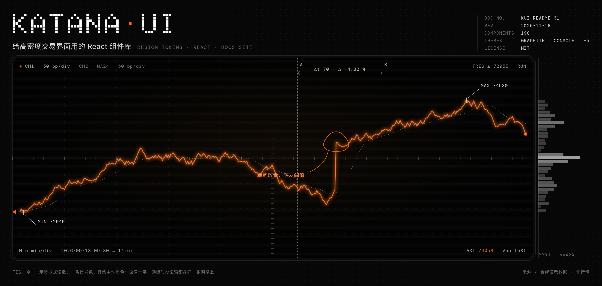
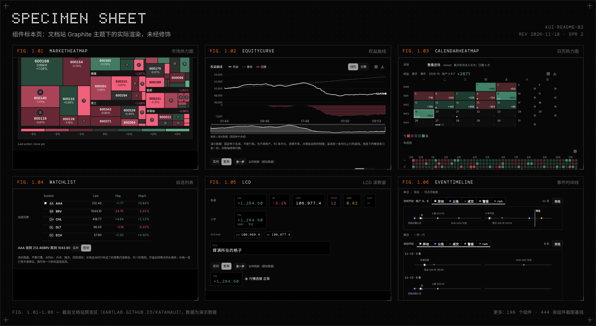
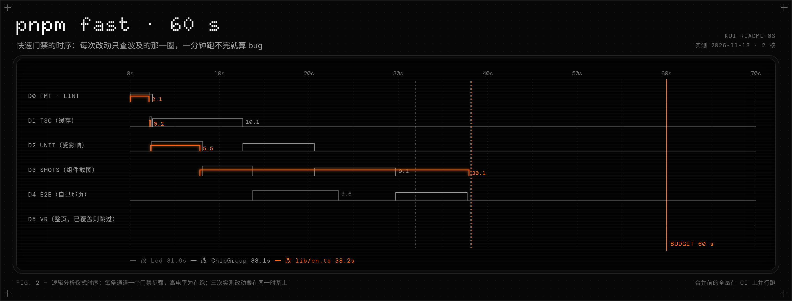

# Katana UI

[English](README.md) · 中文



给高密度交易界面用的 React 组件库：交易台、量化研究、监控看板这类一屏要放很多数、而且数一直在变的界面。设计 token、组件和文档站放在同一个仓库里，MIT 许可。

文档站与在线预览：<https://xartlab.github.io/KatanaUI/>

## 它是什么样的界面

设计系统叫 **Precision Instrument UI（精密仪器式信息界面）**：不是一种视觉风格，是一套信息组织的秩序。判断一个元素只问一句：它承担什么信息？答不上来就去掉。

- **工程文档**管结构：网格、编号、单位、来源行，每个数都能回答「从哪来、什么时候」。
- **科学仪器**管读数：状态灯加文字，阈值线，异常标记，图上只有一个信号色，其余是中性墨色。
- **专业交易工作区**管工作流：固定布局、面板联动、快捷键、高密度表格。

外观对齐 TradingView 的组件，卡片结构参照 Arc，平铺看板参照 OpenBB 与 Bloomberg Launchpad。默认是深色的 Graphite 主题，另有 Console、Paper（浅色）等共七套。



## 里面有什么

| 组 | 例子 |
| --- | --- |
| 表单控件、浮层、布局与导航 | 按钮、输入框、数字输入（可写算式）、日期区间、快捷键录入、对话框、命令面板、侧栏、页签 |
| 读数与状态、反馈 | LCD 读数窗、状态灯、点阵字、滚动数字、Tag、Toast、骨架屏（按真实布局量出来） |
| 报价与行情 | 迷你图（默认、仪器档案、ASCII 三种画法）、自选列表、行情表、报价卡、技术评级仪表、树图 |
| 量化 | 权益曲线、刷选图、日历热力图、地平线图、山脊图、市场热力图、财经日历、涨停梯队 |
| 积木 | 数据表格（列设置、虚拟滚动）、新闻流、决策队列、假设账本、策略报告、系统监控、状态栏 |
| 动效、AI | 文字进场、过场、背景特效（多数移植自 SmoothUI，MIT）；对话、推理、工具调用、审批、来源 |

文档站上一共 225 页，每页有示例、最小用法与源码、属性表、状态、键盘操作和「不要这样用」。

另外几样：

- **三层 token**：调色层 → 语义层 → 语义特征（`--k-*`）。组件只读语义特征，换主题只换调色层。
- **实时刷新动效**：数值闪涨跌色、新条目高亮、行按涨幅换位，信息流不只靠闪烁。
- **A2UI 组件目录**：组件登记成 A2UI v1.0 目录，智能体可以直接用消息拼出界面。
- **shadcn registry**：`https://xartlab.github.io/KatanaUI/r/{name}.json`，可以只取单个组件。

## 怎么保证不改坏



- **组件截图**：每个组件在浏览器里直接渲染，Graphite 与 Console 各一张，用自研的 [pixelgate](https://github.com/2233admin/pixelgate) 逐像素比基线。
- **`pnpm fast`**：平时改完只跑这个。只查改动波及的那一圈：改动文件的格式与 lint、类型检查、受影响的单测、改动件和引用它的件的截图、改动件自己那页的 e2e。预算 60 秒，超了就失败并点名最慢的一步。
- **全量门禁**：单测、整套组件截图、整页视觉回归、e2e（含每页的 axe 无障碍扫描）在 CI 上并行跑；本地要跑用 `pnpm full`。

## 安装

还没发到 npm。先按 release 标签从本仓库装（需要对本仓库有读权限）：

```json
{
  "dependencies": {
    "@katana-ui/react": "git+https://github.com/XartLab/KatanaUI.git#v0.1.0&path:packages/react",
    "@katana-ui/tokens": "git+https://github.com/XartLab/KatanaUI.git#v0.1.0&path:packages/tokens"
  }
}
```

样式的引入顺序与 Tailwind v4 的配合见 [packages/react/README.md](packages/react/README.md)。

## 开发

```sh
pnpm install
pnpm dev          # 文档站
pnpm fast         # 改完先跑这个（一分钟内）
pnpm full         # 全量门禁（单测、组件截图、整页回归、e2e）
pnpm build:site   # 文档站与 shadcn registry
```

给在本仓库干活的 AI agent 的规矩在 [AGENTS.md](AGENTS.md)；贡献说明见 [CONTRIBUTING.md](CONTRIBUTING.md)。

## 许可

MIT，见 [LICENSE](LICENSE)。移植自 SmoothUI 的组件保留原作者署名，见 packages/react 的 NOTICE。
